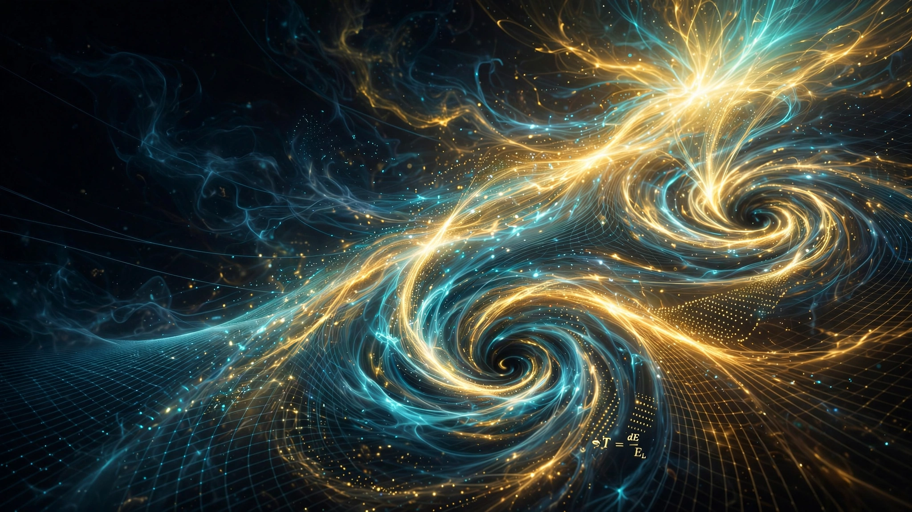

# TCE-Lab
 
Chrono-Energetic Theory Numerical Laboratory
 
## Postulat fondamental
 
Le temps n'est pas une dimension.
 
Le temps est l'énergie locale dissipée divisée par la rigidité du vide :
 
dT = dE_loc / E_L

---
### 📄 Nouvelle Publication V2 — Implications Biologiques & Voyage Spatial
> Si le temps émerge de l'énergie, on peut le ralentir, le figer, le créer.

- **[Lire la publication complète (Markdown)](./TCE_PUBLICATION_V2.md)**
- **[Télécharger le PDF scientifique](./TCE_PUBLICATION_V2.pdf)**
- **[Source LaTeX pour arXiv/HAL](./TCE_PUBLICATION_V2.tex)**

**Formule étendue :** `dt = T_thermo * dS / E_L` — Le temps émerge proportionnellement à la production d'entropie.
**Implication :** `Γ_TCE = E_avail(r) / E_avail(∞)` — Bulle chrono-déplétive pour ralentir le temps sans vitesse relativiste.

---
 
## Contenu
 
- Champs scalaires ND
- Champs de spin Dirac
- Thermodynamique chrono-énergétique
- Gravitation TCE
- Horloge numérique T(E)
 
## Auteur
 
Gregory Lombardo

## Vidéo
Demo TikTok signée : Gregory Lombardo • TCE Chrono-Energetics Theory

Pendant que la physique standard prend le temps comme acquis, je le code comme une conséquence.
Mon code ne tourne pas DANS le temps. Il CRÉE le temps à partir de l'énergie.

Formule: dT = dE / E_L

La gravité ? Ce n'est plus une courbure. C'est un système qui a moins d'énergie disponible pour créer du temps, parce que son énergie potentielle est négative. Moins d'énergie = temps qui ralentit.
